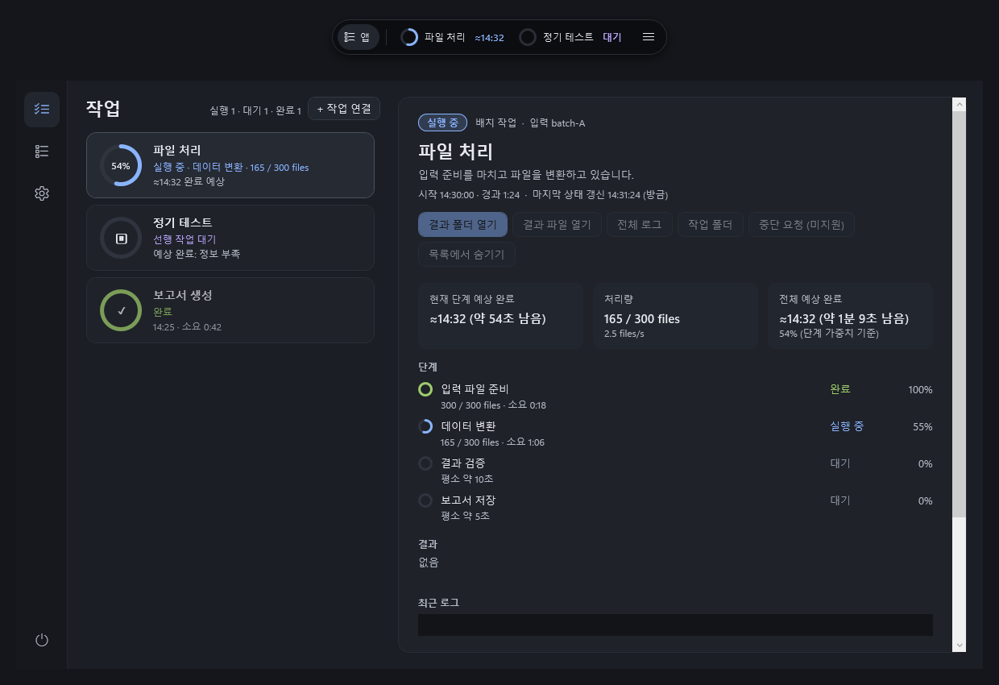

# TaskMonitor

Windows용 **작업 모니터 & 바로가기 런처**.
오래 걸리는 작업의 진행률과 예상 완료 시각을 작은 캡슐에서 확인하세요.



*예시 데이터를 사용한 실제 UI 렌더링입니다.*

## 주요 기능

- **작업 확인** — 완료·실행 중·대기 단계, 처리량, 예상 완료 시각
- **Python 자동 감지** — 실행 중인 작업과 연결된 로그의 진행률 표시
- **다양한 작업 연결** — 파일 처리·학습·테스트 등을 상태 파일이나 공통 로그로 연결
- **바로가기** — 앱·폴더·파일·웹 주소를 등록하고 빠르게 열기

로컬 파일로 동작하며 서버나 로그인은 필요하지 않습니다.

## 실행

Windows와 .NET 10 SDK가 필요합니다.

```bat
build.bat
start_monitor.bat
```

캡슐의 작업이나 `≡`를 누르면 상세 화면이 열립니다.
창을 닫아도 모니터링은 계속되며, 모니터를 종료해도 작업은 계속 실행됩니다.

## 작업 연결

기존 Python 작업은 자동으로 감지합니다.
**작업 → + 작업 연결**에서 실행 중인 프로세스와 상태 파일·로그를 선택할 수 있습니다.
이미 감지된 작업은 **연결 설정**으로 변경하세요. JSON 항목은 자동 선택되며 미리보기에서 확인할 수 있습니다.

코드에서 직접 연결하려면 `taskstate.py` 또는 `TASK_PROGRESS_JSON`을 사용하세요.

Python이 설치되어 있다면 아래 명령으로 데모를 실행할 수 있습니다.

```bat
run_demo.bat
```

진행률·예상 시간은 작업이 제공하는 정보에 따라 달라집니다.

[사용 가이드](docs/USAGE.md) · [작업 연결 예제](docs/GENERIC_TASKS.md) · [상태 파일 규격](docs/STATE_CONTRACT.md)
